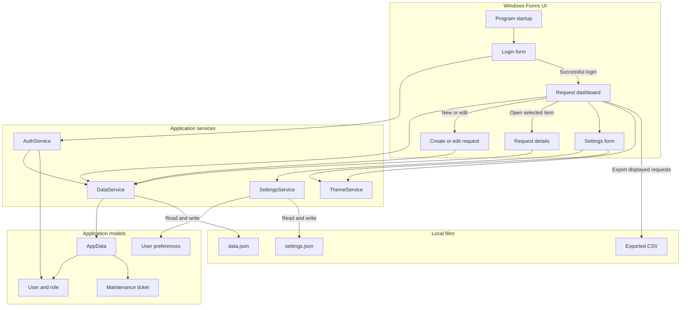
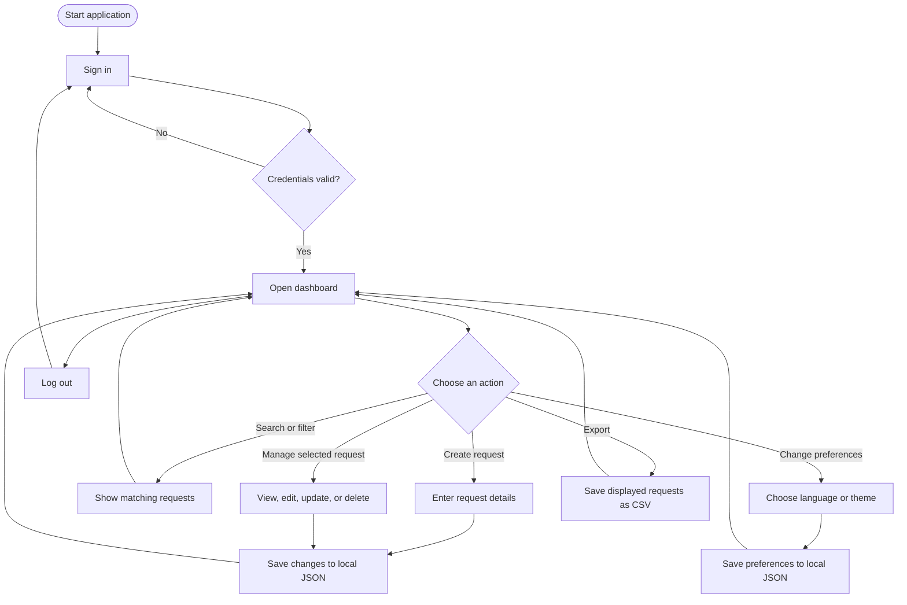

# Application Architecture

This diagram summarizes how the Windows Forms screens, application services, data models, and local files work together.

## Request lifecycle

## Storage

- Request and account data are stored in `%LOCALAPPDATA%\MaintenanceRequestManager\data.json`.
- Language and appearance preferences are stored in `%LOCALAPPDATA%\MaintenanceRequestManager\settings.json`.
- CSV export writes the currently displayed request list to a file selected by the application.

The application uses local files and sample coursework credentials. It is not designed for production use or sensitive data.
